<div align="center">

# Creative Engineering Design 2023 — Harvest & Transport Robots

**Coursework · Seoul National University, Dept. of Mechanical Engineering · Fall 2023 · Team 9**

A hands-on design course: an individual servo gripper and line tracer, then a five-person team project<br>
building two cooperating robots that harvest fruit and deliver it to "refrigerators" on a competition field.


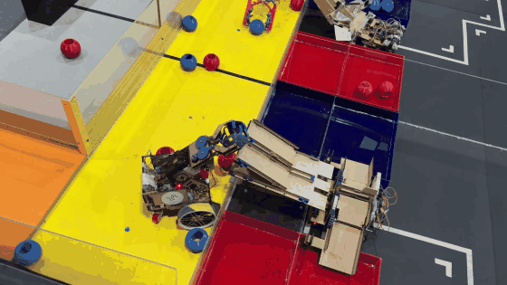

<sub>Competition run (1.5× speed). The transport robot (bottom right) has unfolded into a rail bridge over the refrigerators.</sub>

</div>

---

## Course overview

| Assignment | Type | Summary |
|---|---|---|
| [HW1 · Gripper](#hw1--servo-gripper) | Individual | Servo-driven gripper that lifts a cube, a cylinder and a ball for 3 s |
| [HW2 · Line tracer](#hw2--line-tracer) | Individual | Arduino car that follows a taped line with four IR sensors |
| [Robot project](#robot-project--harvest-and-transport) | Team of 5 | RC harvest robot + autonomous transport robot for a fruit-harvesting game |

Parts were designed in Fusion 360, laser-cut from 3 mm / 4.5 mm MDF and 3D-printed where strength mattered.

---

## HW1 · Servo gripper

Design a gripper driven by a single hobby servo that picks up a 40 mm cube, a Ø45 mm cylinder and a Ø50 mm ball and holds each for three seconds. Two iterations (mk1 / mk2) were modeled; mk2 uses a pair of meshing gears so both jaws close symmetrically from one servo.

<table>
  <tr>
    <td align="center">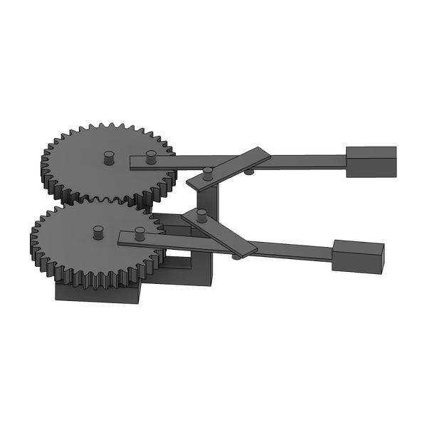<br><sub>mk2 · geared jaws and linkage arms</sub></td>
    <td align="center">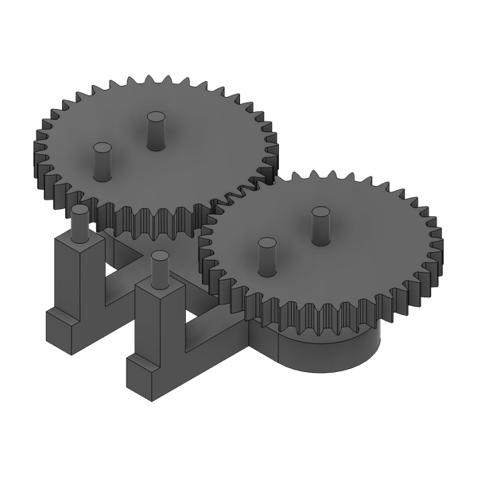<br><sub>mk2 · gear train on the body</sub></td>
  </tr>
</table>

Files: [`hw1-gripper/`](hw1-gripper/) — CAD for both iterations, the submitted design and laser-cutting drawings (PDF).

## HW2 · Line tracer

An Arduino car with two geared DC motors and four IR line sensors. The firmware drives straight while both center sensors see the line, pivots toward the line when one loses it, and uses the outer sensors to detect turn markers. The laser-cut chassis went through three versions.

<table>
  <tr>
    <td align="center">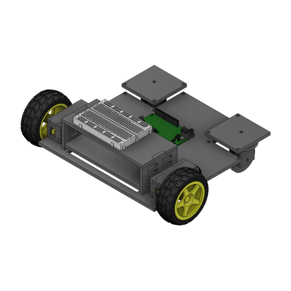<br><sub>Body v2</sub></td>
    <td align="center">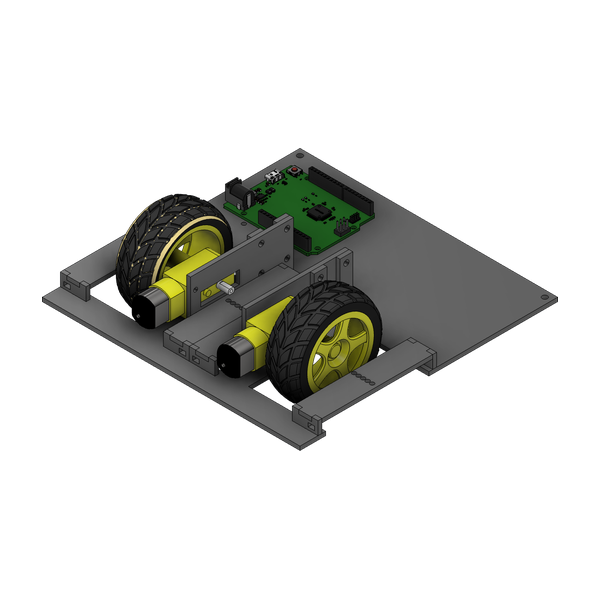<br><sub>Body v3 (final)</sub></td>
  </tr>
</table>

Files: [`hw2-line-tracer/`](hw2-line-tracer/) — CAD, laser-cut layouts, drawings and [`line_tracer.ino`](hw2-line-tracer/firmware/line_tracer/line_tracer.ino).

---

## Robot project · Harvest and transport

### Game: ROBOCON "Tanghuru Factory"

Two teams play on a shared field. Each team runs a **harvest robot** driven by an RC transmitter and an **autonomous transport robot** that follows a white line on a black floor. The goal is to collect fruit and sort it into the matching **baskets** (room temperature) or **fridges** to "make tanghulu".

**Objects**

| Object | Count | Description |
|---|:---:|---|
| Strawberry (red ball) | 5 | Ø70 mm PLA ball, 100 g |
| Blueberry (blue ball) | 5 | Ø70 mm PLA ball, 100 g |
| Black sapphire grape | 3 | 70 × Ø60 mm double cone with a metal core, 280 g — hard to grip and heavy |
| Rock | 1 | 300 × 100 × 150 mm wooden obstacle in the middle of the field |

**Scoring**

| Delivery | Points |
|---|:---:|
| Strawberry / blueberry into the same-color basket | +1 |
| Strawberry / blueberry into the same-color fridge (via the transport robot or directly) | +2 |
| Black sapphire into any basket | +2 |
| Black sapphire into any fridge (via the transport robot or directly) | +4 |
| Fruit into a different-color basket or fridge | 0 |

An object counts when its center of gravity is inside the score zone after everything stops moving. Ties are broken by black sapphires in a basket, then fruit in the correct fridge, then fruit in the correct basket.

**Match flow** (3 min 30 s in total)

1. **Cooperation mission (first 30 s).** The black sapphires sit in a basket on a "grape tree" between the two teams. Each team's harvest robot grips a cube tied to the tree by a string and pulls. The tree only lifts the basket if both teams pull evenly; if it tilts, the grapes fall off.
2. **Harvest and transport (3 min).** Harvest robots may enter the harvesting zone after 30 s, or immediately if the cooperation succeeded. Black sapphires may be touched only from 1 min after entering. In the final contest, harvest robots may also cross the center line after 1 min and play against the opponent.
3. **Finish.** Power is cut at the stop signal and the judges count the points.

**Robot constraints**

| | Harvest robot | Transport robot |
|---|---|---|
| Control | Manual, RC transmitter (8 channels) | Fully autonomous |
| Controller | Arduino Mega | Arduino Uno R4 |
| Actuators | 3 servos, 3 DC motors (GM25 1:171 ×2, 1:500 ×1) | 4 servos, 2 geared DC motors |
| Sensors | — | 4 IR line sensors, 2 ultrasonic |
| Size at start | Fits in a 300 mm cube | Fits in 200 × 200 × 400 mm |
| Mass | ≤ 5.0 kg | ≤ 3.0 kg |

- Robots are built only from the course kit: aluminum and PVC plates, 3 mm / 4.5 mm MDF, aluminum angles, chain gears and steel shafts, plus up to ₩10,000 of extra non-energy-storing material. Each 3D-printed part may weigh at most 60 g.
- Energy may come only from the supplied batteries, from gravity, or from elastic parts the team made — which is why the transport robot uses gravity and a rubber band to unfold.
- Penalties: −1 for late setup, a false start or a transport-robot reset; −2 for touching robots or objects, entering the harvesting zone early, or entering the opponent's transport zone. A team with 4 or more penalty points is disqualified.
- Schedule: performance evaluations on 11/3 and 11/17 (no crossing the center line), then the ROBOCON tournament on 11/24.

### Our strategy

A line tracer is too slow to shuttle fruit back and forth reliably, and fridges are worth double the baskets. So instead of having the transport robot carry fruit, the team made it **drive once to the fridges and turn into a ramp**. The harvest robot drops fruit — including the 280 g black sapphires, too heavy for the transport robot to carry — at the top of the ramp, and gravity rolls it into the fridges.

### Transport robot — my part

The transport robot follows the line to the fridges and **transforms into a rail bridge** that spans from the baskets to the fridges. Fruit placed on the rails rolls straight into the fridges — a "factory line" that turns +1 basket deliveries into +2 fridge deliveries and handles the heavy black sapphire without carrying it.

<table>
  <tr>
    <td align="center">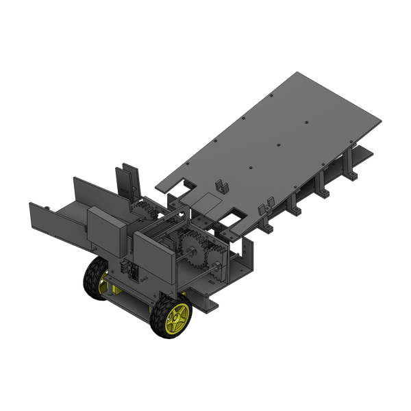<br><sub>Final transport robot</sub></td>
    <td align="center">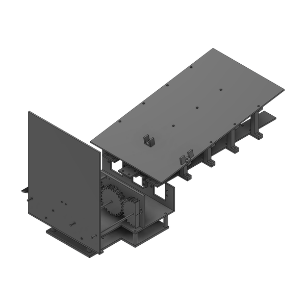<br><sub>Earlier version (v15)</sub></td>
    <td align="center">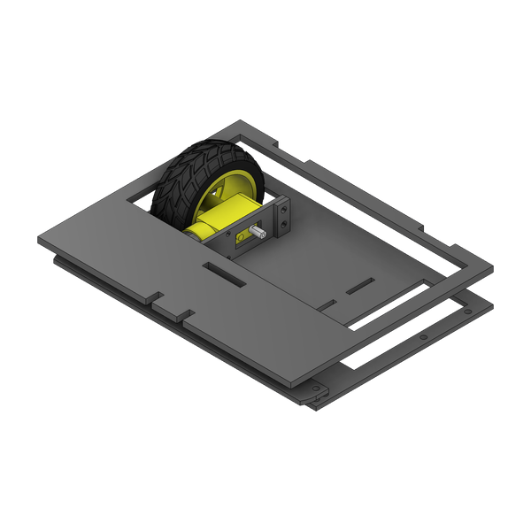<br><sub>First body (before the bridge)</sub></td>
  </tr>
  <tr>
    <td align="center">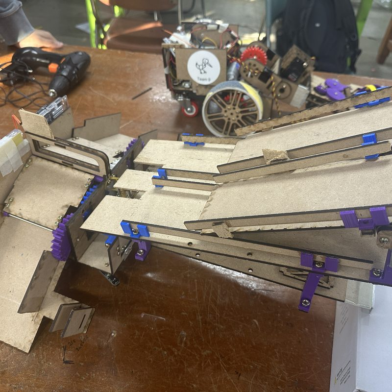<br><sub>Bridge unfolded</sub></td>
    <td align="center">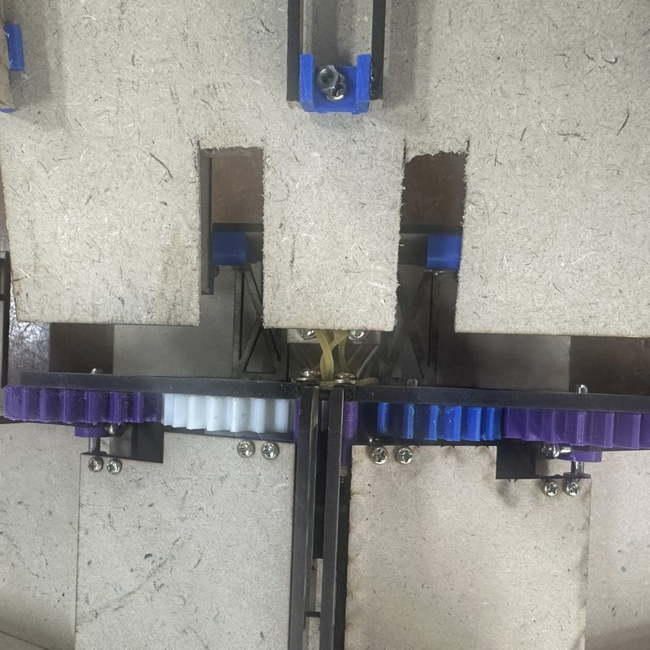<br><sub>Half gears on the side bridges</sub></td>
    <td align="center">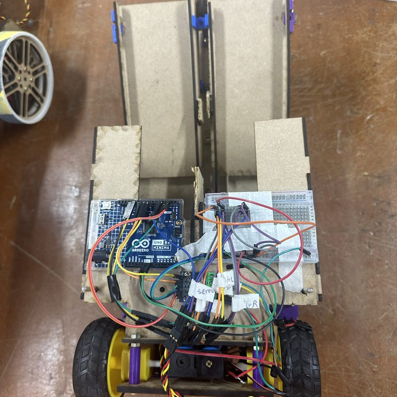<br><sub>Line-tracer circuit</sub></td>
  </tr>
</table>

**Unfolding mechanism**

- The two side bridges are geared together with **3D-printed half gears** and held closed by one servo. Once released, the half gears disengage and gravity finishes opening the bridges, so the servo only carries load at the start of the motion.
- The side bridges in turn latch the front rail bridge (about 500–600 g). When they open, a **rubber band** — replacing an earlier pulley-and-counterweight design — swings the rail bridge down. **One servo unfolds every bridge.**
- Fruit loaded onto the robot before it unfolds also rolls into the fridges, so the robot still delivers fruit itself.

**Iterations**

| Version | Change | Result |
|---|---|---|
| 1 | Side rails slide out on a slider, HS-225 servo | Too much friction, the side rail did not deploy |
| 2 | Hinged side bridges, HS-645 servo holding the bridges | Bridges worked, but no room for the circuit under the inverted-V chute |
| 3 | Shortened inverted-V chute, circuit moved to the back | Easy to service, but the black sapphire stalled on the rail |
| Final | Steeper incline at the top of the rail, extra rubber bands | Black sapphire slides into the refrigerator; a right-angle frame hooks the bridge onto the wall so the robot does not get pushed back |

The robot body is cut from 3 mm MDF (the 4.5 mm stock was reserved for the harvest arm), with 3D-printed gears, rail guards, incline and hinges. Firmware: [`transport.ino`](robot-project/transport-robot/firmware/transport/transport.ino).

### Harvest robot — team

<table>
  <tr>
    <td align="center">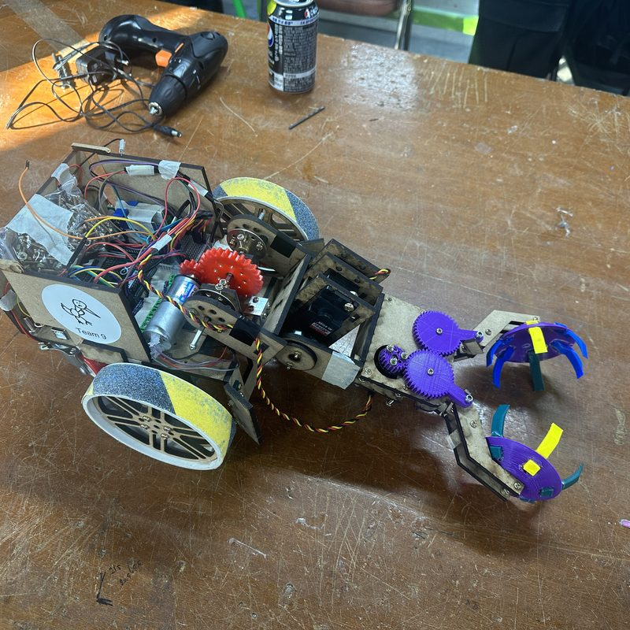<br><sub>Final harvest robot</sub></td>
    <td align="center">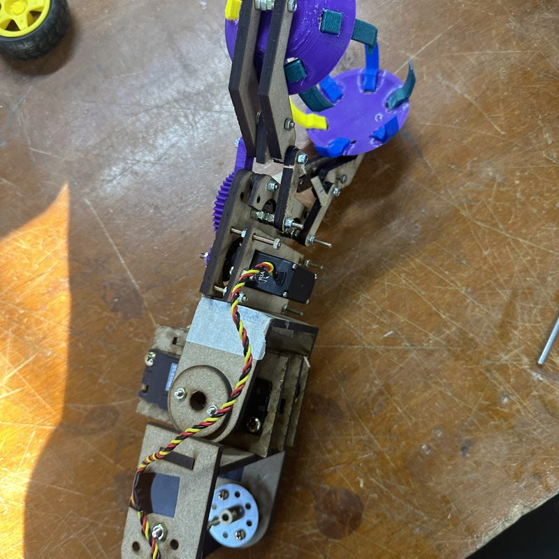<br><sub>2-DOF arm + gripper</sub></td>
    <td align="center">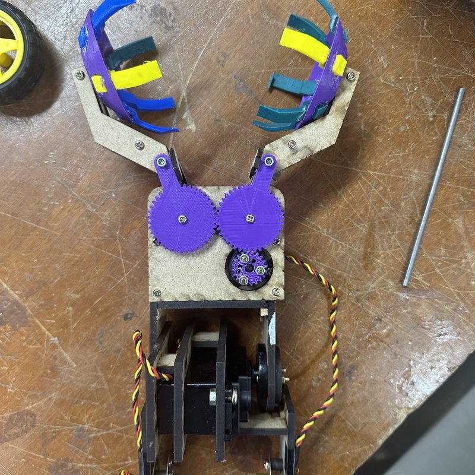<br><sub>"Flytrap" gripper</sub></td>
  </tr>
  <tr>
    <td align="center">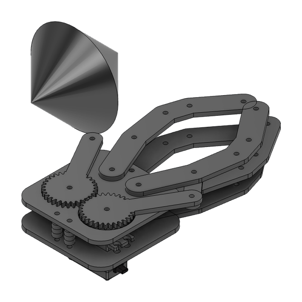<br><sub>Gripper CAD</sub></td>
    <td align="center">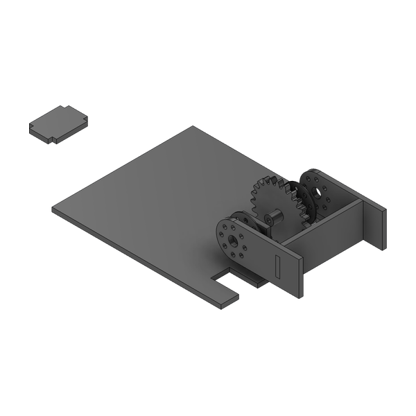<br><sub>Arm base · 500:1 DC motor</sub></td>
    <td align="center">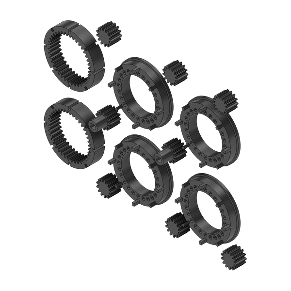<br><sub>Wheel rims</sub></td>
  </tr>
</table>

- **Wheels** — five designs were tested (delta wheel, tri-spoke, rubber-tube gear, chain-linked PVC pipes, and finally two large sandpaper-covered wheels with rear casters) to balance ramp climbing against quick, stable turning.
- **Arm** — started as a crane of two four-bar linkages driven by HS-815BB / HS-645MG servos. The large servo browned out the battery under the black sapphire's weight, so the final arm uses a 500:1 DC motor with a 2:1 gear stage and a shorter 2-DOF linkage.
- **Gripper** — an MDF four-bar gripper was replaced by a 3D-printed "flytrap" claw with geared jaws, which holds both the balls and the heavy black sapphire.
- **Control** — each motor maps to an RC transmitter channel; drive speed scales with stick deflection, and the stick is split into forward / back / left / right sectors to avoid conflicting commands.

Files: [`robot-project/`](robot-project/) — transport and harvest robot CAD (`.f3d`), 3D-print files (`.stl`), laser-cut sheets (`.dxf`, PDF) and firmware.

### Report

The full team report, with design alternatives, kinematic and force analysis and test results, is in [`docs/Team9_Final_Report.pdf`](docs/Team9_Final_Report.pdf).

---

## Repository structure

```
.
├── hw1-gripper/
│   ├── cad/               # mk1, mk2 and the submitted gripper (.f3d)
│   └── drawings/          # laser-cut layouts (PDF)
├── hw2-line-tracer/
│   ├── cad/               # body v1–v3, wheel parts, cut layouts
│   ├── drawings/
│   └── firmware/          # line_tracer.ino
├── robot-project/
│   ├── transport-robot/   # cad (final, iterations, parts), stl, firmware
│   ├── harvest-robot/     # cad (gripper, arm, wheels), stl
│   └── laser-cut/         # dxf sheets, Fusion layouts, drawings (PDF)
└── docs/                  # final report and README images
```

`.f3d` files open in Autodesk Fusion 360. Course handouts, purchased-part models (servos, Arduino boards, sensors) and team photos are not included.
