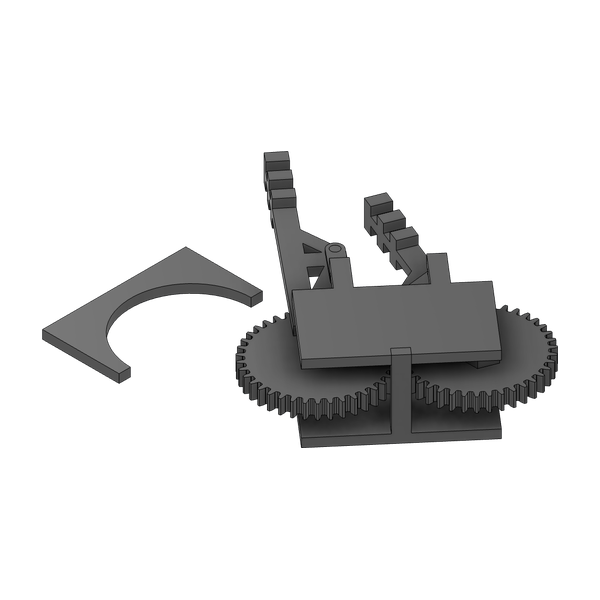
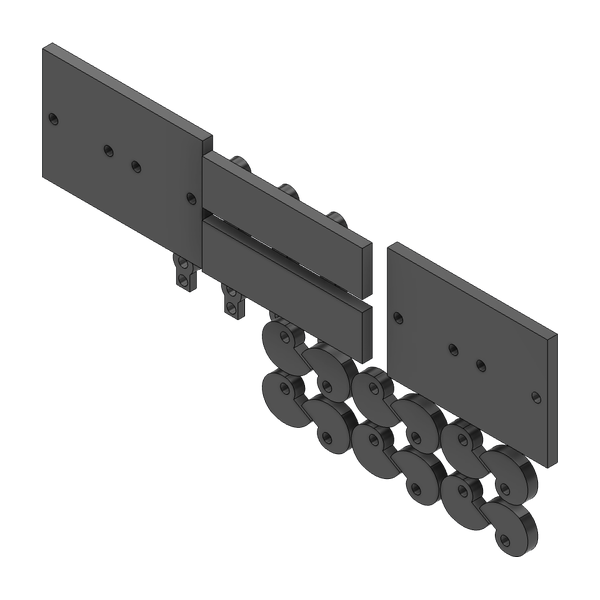
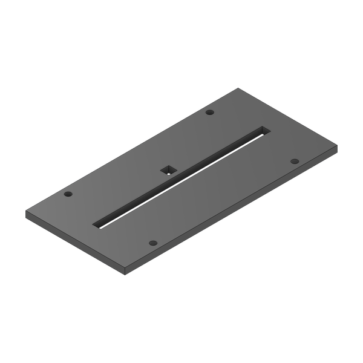

<div align="center">

# Creative Engineering Design 2023 — Harvest & Transport Robots

**Coursework · Seoul National University, Dept. of Mechanical Engineering · Fall 2023 · Team 9**

A hands-on design course: an individual servo gripper and line tracer, then a five-person team project<br>
building two cooperating robots that harvest fruit and deliver it to "refrigerators" on a competition field.


<sub>Competition run (1.5× speed). The transport robot (bottom right) has unfolded into a rail bridge over the refrigerators.</sub>

</div>

---

## Course overview

| Assignment | Type | Summary |
|---|---|---|
| [HW1 · Gripper](#hw1--servo-gripper) | Individual | Servo-driven gripper that lifts a cube, a cylinder and a ball for 3 s |
| [HW2 · Line tracer](#hw2--line-tracer) | Individual | Arduino car that follows a taped line with four IR sensors |
| [Robot project](#robot-project--harvest-and-transport) | Team of 5 | RC harvest robot + autonomous transport robot for a fruit-harvesting game |

Parts were designed in Fusion 360, laser-cut from 3 mm / 4.5 mm MDF and 3D-printed where strength mattered.

---

## HW1 · Servo gripper

Design a gripper driven by a single hobby servo that picks up a 40 mm cube, a Ø45 mm cylinder and a Ø50 mm ball and holds each for three seconds. Two iterations (mk1 / mk2) were modeled; mk2 uses a pair of meshing gears so both jaws close symmetrically from one servo.

<table>
  <tr>
    <td align="center"><br><sub>mk2 · geared jaws</sub></td>
    <td align="center"><br><sub>mk2 · revised body</sub></td>
    <td align="center"><br><sub>mk1 · laser-cut layout</sub></td>
  </tr>
</table>

Files: [`hw1-gripper/`](hw1-gripper/) — CAD for both iterations, the submitted design and laser-cutting drawings (PDF).

## HW2 · Line tracer

An Arduino car with two geared DC motors and four IR line sensors. The firmware drives straight while both center sensors see the line, pivots toward the line when one loses it, and uses the outer sensors to detect turn markers. The laser-cut chassis went through three versions.

<table>
  <tr>
    <td align="center"><br><sub>Body v1</sub></td>
    <td align="center"><br><sub>Body v2</sub></td>
    <td align="center"><br><sub>Body v3 (final)</sub></td>
  </tr>
</table>

Files: [`hw2-line-tracer/`](hw2-line-tracer/) — CAD, laser-cut layouts, drawings and [`line_tracer.ino`](hw2-line-tracer/firmware/line_tracer/line_tracer.ino).

---

## Robot project · Harvest and transport

**Mission.** Fruit (balls) and a heavy "black sapphire" (~280 g) are scattered on the field. A remote-controlled **harvest robot** picks them up and sorts them into refrigerators and room-temperature storage, while an autonomous **transport robot** follows a line across the field. Fruit carried by the transport robot earns a bonus.

### Transport robot — my part

A line tracer is too slow to shuttle fruit back and forth reliably, so instead of making many trips the transport robot drives once to the refrigerators and **transforms into a rail bridge**. The harvest robot then drops fruit onto the rails and it rolls straight into the refrigerators — a "factory line" that also handles the heavy black sapphire without carrying it.

<table>
  <tr>
    <td align="center"><br><sub>Final transport robot</sub></td>
    <td align="center"><br><sub>Front bridge section</sub></td>
    <td align="center"><br><sub>Earlier version (v15)</sub></td>
  </tr>
  <tr>
    <td align="center"><br><sub>Bridge unfolded</sub></td>
    <td align="center"><br><sub>Half gears on the side bridges</sub></td>
    <td align="center"><br><sub>Line-tracer circuit</sub></td>
  </tr>
</table>

**Unfolding mechanism**

- The two side bridges are geared together with **3D-printed half gears** and held closed by one servo. Once released, the half gears disengage and gravity finishes opening the bridges, so the servo only carries load at the start of the motion.
- The side bridges in turn latch the front rail bridge (about 500–600 g). When they open, a **rubber band** — replacing an earlier pulley-and-counterweight design — swings the rail bridge down. **One servo unfolds every bridge.**
- Fruit carried on the robot rolls into the refrigerators once the robot is unfolded, collecting the transport bonus.

**Iterations**

| Version | Change | Result |
|---|---|---|
| 1 | Side rails slide out on a slider, HS-225 servo | Too much friction, the side rail did not deploy |
| 2 | Hinged side bridges, HS-645 servo holding the bridges | Bridges worked, but no room for the circuit under the inverted-V chute |
| 3 | Shortened inverted-V chute, circuit moved to the back | Easy to service, but the black sapphire stalled on the rail |
| Final | Steeper incline at the top of the rail, extra rubber bands | Black sapphire slides into the refrigerator; a right-angle frame hooks the bridge onto the wall so the robot does not get pushed back |

The robot body is cut from 3 mm MDF (the 4.5 mm stock was reserved for the harvest arm), with 3D-printed gears, rail guards, incline and hinges. Firmware: [`transport.ino`](robot-project/transport-robot/firmware/transport/transport.ino).

### Harvest robot — team

<table>
  <tr>
    <td align="center"><br><sub>Final harvest robot</sub></td>
    <td align="center"><br><sub>2-DOF arm + gripper</sub></td>
    <td align="center"><br><sub>"Flytrap" gripper</sub></td>
  </tr>
  <tr>
    <td align="center"><br><sub>Gripper CAD</sub></td>
    <td align="center"><br><sub>Arm base · 500:1 DC motor</sub></td>
    <td align="center"><br><sub>Wheel rims</sub></td>
  </tr>
</table>

- **Wheels** — five designs were tested (delta wheel, tri-spoke, rubber-tube gear, chain-linked PVC pipes, and finally two large sandpaper-covered wheels with rear casters) to balance ramp climbing against quick, stable turning.
- **Arm** — started as a crane of two four-bar linkages driven by HS-815BB / HS-645MG servos. The large servo browned out the battery under the black sapphire's weight, so the final arm uses a 500:1 DC motor with a 2:1 gear stage and a shorter 2-DOF linkage.
- **Gripper** — an MDF four-bar gripper was replaced by a 3D-printed "flytrap" claw with geared jaws, which holds both the balls and the heavy black sapphire.
- **Control** — each motor maps to an RC transmitter channel; drive speed scales with stick deflection, and the stick is split into forward / back / left / right sectors to avoid conflicting commands.

Files: [`robot-project/`](robot-project/) — transport and harvest robot CAD (`.f3d`), 3D-print files (`.stl`), laser-cut sheets (`.dxf`, PDF) and firmware.

### Report

The full team report, with design alternatives, kinematic and force analysis and test results, is in [`docs/Team9_Final_Report.pdf`](docs/Team9_Final_Report.pdf).

---

## Repository structure

```
.
├── hw1-gripper/
│   ├── cad/               # mk1, mk2 and the submitted gripper (.f3d)
│   └── drawings/          # laser-cut layouts (PDF)
├── hw2-line-tracer/
│   ├── cad/               # body v1–v3, wheel parts, cut layouts
│   ├── drawings/
│   └── firmware/          # line_tracer.ino
├── robot-project/
│   ├── transport-robot/   # cad (final, iterations, parts), stl, firmware
│   ├── harvest-robot/     # cad (gripper, arm, wheels), stl
│   └── laser-cut/         # dxf sheets, Fusion layouts, drawings (PDF)
└── docs/                  # final report and README images
```

`.f3d` files open in Autodesk Fusion 360. Course handouts, purchased-part models (servos, Arduino boards, sensors) and team photos are not included.
